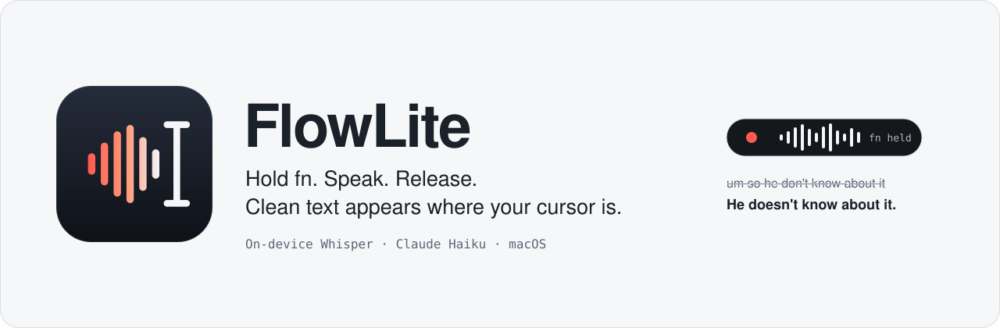
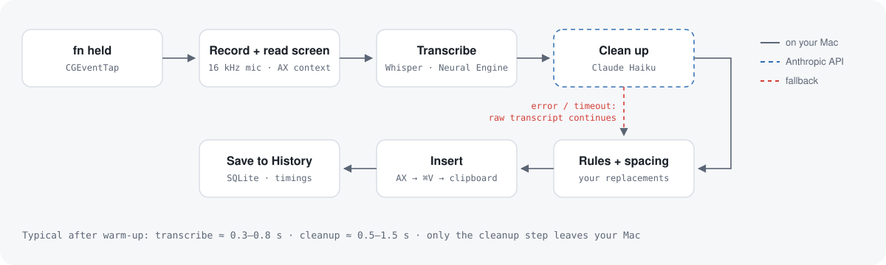

<p align="center">
  <picture>
    <source media="(prefers-color-scheme: dark)" srcset="assets/banner-dark.svg">
    
  </picture>
</p>

<p align="center">
  <a href="LICENSE"></a>
  
  
  
  
</p>

<p align="center">
  <a href="https://flowlite.jenishvaghasiya.me"><b>Website</b></a> ·
  <a href="#install">Install</a> ·
  <a href="#how-it-works">How it works</a> ·
  <a href="#privacy">Privacy</a>
</p>

**FlowLite** is a voice-dictation app for macOS that lives in your menu bar. Hold the **fn** key, say what you want to write, and let go: your speech is transcribed on your Mac, cleaned up, and typed into whatever text field you're in. Mail, Slack, your editor, the terminal, a browser form.

- **Fast and private transcription.** Whisper runs locally on the Apple Neural Engine. Your audio never leaves your Mac.
- **Text that reads like you typed it.** Claude Haiku removes filler words, applies your spoken corrections, fixes punctuation and grammar, and matches the tone of the app you're writing in.
- **Works everywhere.** No plugins or per-app setup. FlowLite types into the focused field the way you would.

---

## Contents

- [Features](#features)
- [How it works](#how-it-works)
- [Privacy](#privacy)
- [Requirements](#requirements)
- [Install](#install)
- [First run](#first-run)
- [Using FlowLite](#using-flowlite)
- [Settings](#settings)
- [Architecture](#architecture)
- [Development](#development)
- [Troubleshooting](#troubleshooting)
- [Roadmap](#roadmap)
- [Contributing](#contributing)
- [License](#license)

## Features

| | |
|---|---|
| **Push-to-talk dictation** | Hold fn, speak, release. Text appears at your cursor, typically within 1.5 seconds. |
| **Hands-free mode** | Double-tap fn to keep recording without holding the key; tap once more to finish. |
| **Smart cleanup** | Removes "um", "uh" and false starts; turns "Tuesday, no wait, Wednesday" into "Wednesday"; formats spoken lists; adds punctuation. |
| **Grammar fixes** | *Standard* editing fixes clear mistakes ("he don't know" → "He doesn't know") while keeping your words. *Light* editing leaves your grammar as spoken. |
| **Context-aware** | Knows which app you're in and what's around your cursor, so it continues your sentence and matches the tone: casual in chat, standard in email, exact in code. |
| **Command mode** | Select text, hold Control + fn, and say "make this more formal" or "translate to Spanish". The selection is rewritten. |
| **Personal dictionary** | Teach it names and jargon so they're spelled right, plus replacements like "my email" → your address. |
| **History** | Search every dictation with its raw transcript, final text, app and timings. |
| **Never loses your words** | If cleanup fails, times out or you're offline, the raw transcript is inserted instead. |

## How it works

<picture>
  <source media="(prefers-color-scheme: dark)" srcset="assets/pipeline-dark.svg">
  
</picture>

1. **You press fn.** A system-wide keyboard listener starts recording immediately, so your first word isn't clipped. A press shorter than 0.3 s counts as an accidental tap and is ignored.
2. **It listens and reads the screen.** The microphone is captured at 16 kHz. Meanwhile the Accessibility API reads the app name and the text around your cursor: up to 1,500 characters before it, your selection, and 500 after. Password fields are never read.
3. **Whisper transcribes on-device.** [WhisperKit](https://github.com/argmaxinc/WhisperKit) runs `large-v3-turbo` on the Neural Engine. Your vocabulary is passed in as a hint for spelling.
4. **Claude Haiku cleans it up.** The transcript and context go to `claude-haiku-5-5` with strict editing rules. It edits rather than writes, and it never answers or obeys what you dictated.
5. **Your rules run.** Replacements are applied exactly, and a leading space is added only when the text before your cursor needs one.
6. **The text is inserted.** FlowLite inserts through Accessibility and verifies the field changed. In apps where that's unreliable (terminals, Chromium browsers, Electron apps) it pastes with ⌘V and restores your clipboard afterwards.
7. **It's saved to History,** with timings for each step.

A longer illustrated walkthrough is in [`docs/flowlite-explained.html`](docs/flowlite-explained.html).

## Privacy

| Data | Where it goes |
|---|---|
| Audio | Stays on your Mac. Transcription is local. The last 5 recordings are kept as WAV files for debugging in `~/Library/Application Support/FlowLite/Recordings`. |
| Transcript and nearby text | Sent to the Anthropic API for cleanup, using your own key. Turn cleanup off and nothing leaves your Mac. |
| Password fields | Never read, never sent for cleanup, never saved to History, no audio kept. |
| API key | Stored in the macOS Keychain. |
| History | A local SQLite database at `~/Library/Application Support/FlowLite/flowlite.sqlite`. Clear it any time from the History window. |

FlowLite has no account, no telemetry and no server of its own.

## Requirements

- A Mac with **Apple Silicon** (M1 or later)
- **macOS 15** Sequoia or later
- **Xcode 16** or later (developed with Xcode 26)
- [Homebrew](https://brew.sh), for XcodeGen
- About **2 GB** of free disk space for the speech model
- An **Anthropic API key** for cleanup ([console.anthropic.com](https://console.anthropic.com)). Optional: without one, FlowLite inserts the raw transcript.

## Install

FlowLite is built from source. The whole process takes a few minutes, plus the first compile of its dependencies.

```bash
git clone https://github.com/Jenish109/flowlite.git
cd flowlite
brew install xcodegen

# One time: create a local code-signing certificate so macOS remembers
# FlowLite's permissions across rebuilds. Asks for your login password.
Scripts/make-signing-identity.sh

# Build, sign and install to ~/Applications, then launch.
Scripts/build.sh --run
```

The first time `codesign` uses the new certificate, macOS asks to allow access to its key. Enter your login password and click **Always Allow**; later builds sign silently.

> [!NOTE]
> Skipping `make-signing-identity.sh` still works: `build.sh` falls back to ad-hoc signing. macOS then treats every rebuild as a new app, so you'll have to grant the permissions again after each build.

## First run

1. **Grant permissions.** Click the FlowLite icon in the menu bar. It shows a warning triangle until setup is done. Grant **Microphone**, **Accessibility** (to read context and insert text) and **Input Monitoring** (for the fn key). After granting Input Monitoring, quit and reopen FlowLite.
2. **Let the speech model download.** About 1.5 GB, shown as "Downloading speech model… N%". The first load then compiles the model for the Neural Engine, which can take a few minutes. Later launches take seconds. Keep FlowLite running until the menu says **Ready**.
3. **Free up the fn key.** In **System Settings › Keyboard**, set **Press 🌐 key to** → **Do Nothing**, so macOS doesn't open the emoji picker or its own dictation.
4. **Add your API key.** **FlowLite menu › Settings… › Cleanup**, paste your Anthropic key, and click **Save**.
5. **Try it.** Click into any text field, hold **fn**, say "um so this is uh really working", and release.

## Using FlowLite

| Action | How |
|---|---|
| Dictate | Hold **fn**, speak, release |
| Hands-free dictation | Double-tap **fn**; tap **fn** again to stop |
| Rewrite selected text | Select text, hold **Control**, then hold **fn**, say the instruction, release |
| Cancel | **Esc** while recording, or press any other key while holding fn |
| Paste a result that couldn't be inserted | When no text field is focused, the text is on your clipboard: press **⌘V** |

While you speak, a small pill at the bottom of the screen shows a live level meter, then "Transcribing…". It never takes focus away from the app you're typing in.

## Settings

| Setting | Options | Default |
|---|---|---|
| Dictation key | fn (🌐), Right Option | fn |
| Language | Auto-detect, English, Hindi, Gujarati, Spanish, French, German | Auto-detect |
| Speech model | Large v3 Turbo (best), Small English (fastest) | Large v3 Turbo |
| Cleanup | On / Off | On (needs an API key) |
| Editing | **Light**: punctuation and fillers only. **Standard**: also fixes grammar | Standard |
| Vocabulary | Words and names to spell correctly, one per line | Empty |
| Replacements | "When I say" → "Insert", with case and whole-word options | Empty |

## Architecture

FlowLite is a single native process with three layers. Each layer depends only on the one below it.

```
App/                    SwiftUI shell: menu bar, overlay, Settings, History, wiring
FlowLiteKit/
├─ FlowLiteSystem/      macOS integrations (compile-only, exercised manually)
│  ├─ HotkeyMonitor     CGEventTap → hotkey state machine
│  ├─ AudioRecorder     AVAudioEngine → 16 kHz mono Float32
│  ├─ AXContextReader   frontmost app + focused text field via Accessibility
│  ├─ AXTextInserter    Accessibility insert → verify → ⌘V paste → clipboard
│  ├─ WhisperTranscriber WhisperKit wrapper, one transcription at a time
│  └─ Keychain, Permissions
└─ FlowLiteCore/        pure logic, fully unit-tested
   ├─ DictationCoordinator  record → transcribe → clean → insert → save, with timeouts and fallbacks
   ├─ HotkeyStateMachine    hold, tap, double-tap lock, command chord, cancel
   ├─ PromptBuilder         Haiku prompts, context truncation, tag-injection protection
   ├─ AnthropicCleaner      Messages API over HTTPS (no SDK dependency)
   ├─ TextRules             replacement rules and insertion spacing
   ├─ FlowStore             SQLite (GRDB): history, vocabulary, rules
   └─ Audio, Timeout        level metering, WAV encoding, async timeouts
```

**Design principles**

- **Every OS dependency sits behind a protocol.** The coordinator only sees `AudioRecording`, `ContextReading`, `Transcribing`, `Cleaning` and `TextInserting`, so the whole pipeline is tested with fakes.
- **Nothing on the hot path can hang the app.** Context reading, transcription and cleanup each have a time limit, and a stuck stage never blocks the next press of fn.
- **Privacy fails closed.** If FlowLite can't tell whether a field is a password field in time, it treats it as one.
- **Only public APIs.** No private frameworks and no sandbox exceptions beyond what Accessibility and event taps require.

The original design spec and the step-by-step build plan are in [`docs/superpowers/`](docs/superpowers/).

## Development

```bash
cd FlowLiteKit
swift test                       # 94 tests, about a minute after the first build
swift build                      # compile the core and system layers
```

```bash
Scripts/build.sh                 # Release build, sign, install to ~/Applications
Scripts/build.sh --run           # ...and launch it
```

`Scripts/build.sh` regenerates `FlowLite.xcodeproj` from [`project.yml`](project.yml) with XcodeGen each time; the project file isn't checked in.

### Tuning the cleanup prompt

`flowlite-golden` runs recorded clips through the real transcription and cleanup pipeline and compares the output with what you expected:

```bash
cd FlowLiteKit
ANTHROPIC_API_KEY=sk-ant-... swift run -c release flowlite-golden ../Tools/golden
swift run -c release flowlite-golden ../Tools/golden --no-clean   # transcription only
```

Your last 5 dictations are saved as WAV files in `~/Library/Application Support/FlowLite/Recordings`. Copy good examples into `Tools/golden/` and describe them in `cases.json`. See [`Tools/golden/README.md`](Tools/golden/README.md).

### Testing in real apps

[`docs/manual-test-checklist.md`](docs/manual-test-checklist.md) lists the apps and edge cases to check before a release: Notes, TextEdit, Safari, Chrome, Slack, VS Code, Terminal, Messages, password fields, offline, and switching microphones.

### Debugging

Every dictation in **History** records the raw transcript, the final text, the insert method (`ax`, `paste`, `clipboard`), the timing of each stage and any error. Logs:

```bash
log stream --predicate 'process == "FlowLite"' --style compact
```

## Troubleshooting

| Symptom | Fix |
|---|---|
| Holding fn does nothing | Grant **Input Monitoring**, then quit and reopen FlowLite. Check that **Press 🌐 key to** is set to **Do Nothing**. |
| Emoji picker opens when pressing fn | Set **System Settings › Keyboard › Press 🌐 key to** → **Do Nothing**. |
| "Speech model failed to load" | Use **Retry loading speech model** in the menu. Check your internet connection and free disk space. |
| Text goes to the clipboard instead of the app | No text field was focused, or the app doesn't expose one. Click into the field and press ⌘V. |
| "Inserted without cleanup" | No API key, offline, or Haiku didn't answer in time. The raw transcript was inserted; check History for the error. |
| Permissions reset after every build | Run `Scripts/make-signing-identity.sh` once so builds are signed with a stable certificate. |
| The first dictation after launch is slow | The model warms up on the first use; later dictations are much faster. |

## Roadmap

- [ ] Streaming transcription while you speak
- [ ] Per-app styles (for example, always casual in Slack)
- [ ] App icon and a notarized, downloadable release
- [ ] Pick any model compatible with the OpenAI API (including a local Ollama) for cleanup
- [ ] Golden-set results in CI

## Contributing

Issues and pull requests are welcome.

1. Fork the repo and create a branch.
2. Keep logic in `FlowLiteCore` and cover it with tests (`swift test`). Keep macOS API calls in `FlowLiteSystem`.
3. For changes to insertion, the hotkey or audio, run through `docs/manual-test-checklist.md` and say which apps you tested.
4. Open a pull request describing the change and how you checked it.

## License

FlowLite is free software released under the [GNU General Public License v3.0](LICENSE). You can use, study, change and share it. If you distribute a modified version, you must release its source under the same license.

## Acknowledgements

- [WhisperKit](https://github.com/argmaxinc/WhisperKit) by Argmax, for on-device Whisper on Apple Silicon
- [GRDB.swift](https://github.com/groue/GRDB.swift), for SQLite
- [Anthropic](https://www.anthropic.com), for the Claude API
- [XcodeGen](https://github.com/yonaskolb/XcodeGen), for generating the Xcode project
